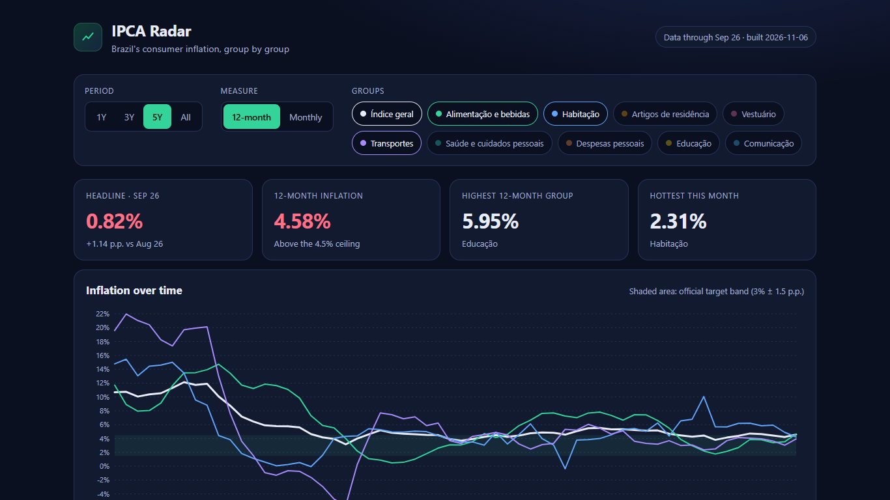
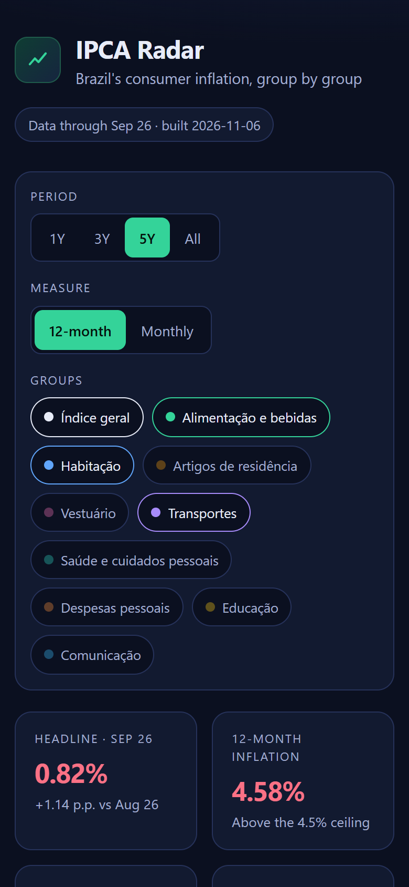

# IPCA Radar

Interactive dashboard of Brazil's official consumer inflation (**IPCA**) by spending group.
A Python/pandas ETL pulls open data from IBGE, writes a compact JSON, and a dependency-free static front-end renders KPIs, filters and charts. GitHub Actions refreshes everything weekly.

**Live:** https://alissonlittig.github.io/ipca-radar/

| Desktop | Mobile (390px) |
|---|---|
|  |  |

## Features
- KPIs: headline monthly rate, 12-month rate vs the 3% ± 1.5 p.p. target band, highest 12-month group, hottest group of the month
- Interactive line chart (hover/touch crosshair + tooltip) with period (1Y/3Y/5Y/All), measure (monthly / 12-month) and group filters
- Ranking of groups by 12-month inflation with each group's basket weight
- 12-month heatmap, plus an accessible "view as table" fallback for the chart
- Responsive down to 390px, keyboard navigable, ARIA radiogroups, reduced-motion aware

## Stack
- **ETL:** Python 3.12, pandas, requests, pytest — `etl/etl.py`
- **Front:** vanilla HTML/CSS/JS with hand-built SVG charts (no frameworks, no build step)
- **CI/CD:** GitHub Actions (tests → ETL → deploy to GitHub Pages, weekly cron)

## Data
IBGE SIDRA table 7060 (IPCA, variables 63 monthly, 66 weight, 2265 12-month), national level, 9 groups plus the headline index. Open data, no login or key. Output: `site/data/ipca.json`.

## Run locally
```bash
pip install -r requirements.txt
python -m pytest -q tests
python etl/etl.py           # refreshes site/data/ipca.json
python -m http.server -d site 8000
```
